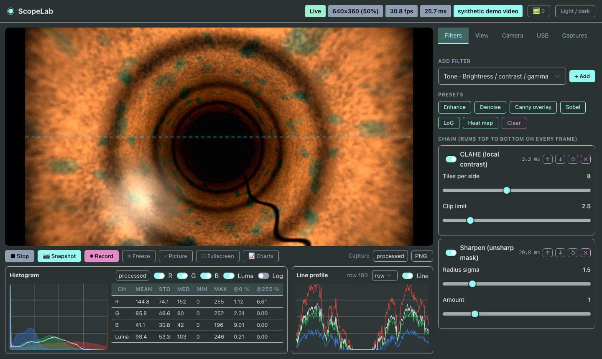
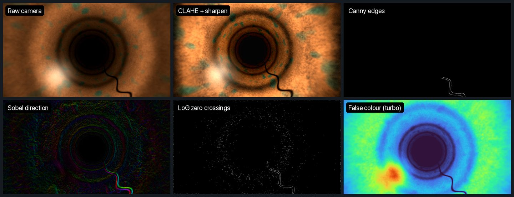
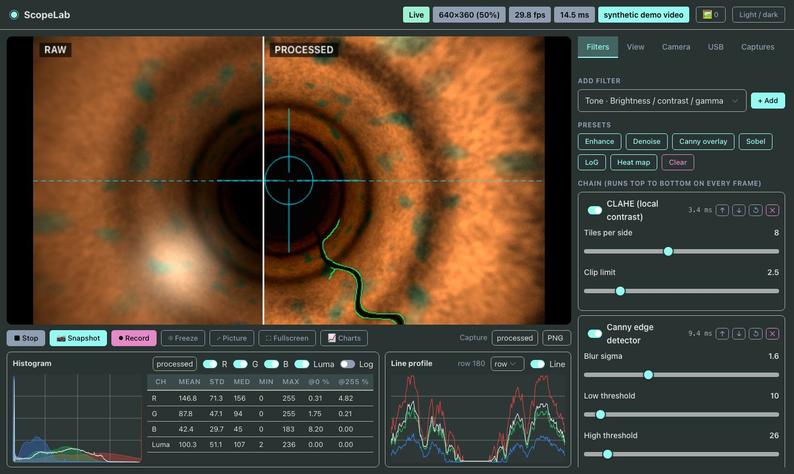
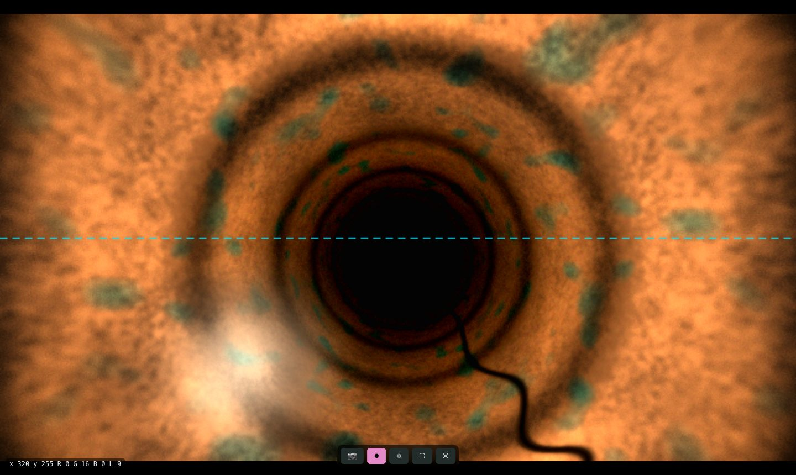

# ScopeLab

**A live USB endoscope viewer with an image-processing lab, in your browser.**
Plug in a USB endoscope (or any webcam) and watch it live. Stack classical
filters such as CLAHE, Canny, Sobel and LoG, read live histograms and line
profiles, and save snapshots and video. There's nothing to install and no
account. Everything runs on your computer, and the video never leaves it.

### ▶ [Open ScopeLab](https://deftio.github.io/scopelab/)

[](https://github.com/deftio/scopelab/actions/workflows/pages.yml)
[](https://github.com/deftio/bitwrench)



<sub>Screenshots use a synthetic "inside a corroded pipe" test video, not a real endoscope.</sub>

---

## What it can do

### Stack classical filters on the live video

Pick filters from a list or use a one-click preset. They run top to bottom on
every frame, and each stage shows its own parameters and how many milliseconds
it costs.



| Group | Filters |
|---|---|
| Tone | Brightness / contrast / gamma / saturation, grayscale, invert, auto levels, histogram equalisation, **CLAHE** (local contrast) |
| Smooth | **Gaussian**, box, **median** (3×3 / 5×5), **bilateral** (edge-preserving), sharpen (unsharp mask) |
| Edges | **Sobel**, Scharr, Prewitt (magnitude / x / y / direction as colour), **Laplacian / LoG** (absolute / signed / zero crossings), **Canny** (alone or drawn over the image), emboss |
| Segment | Threshold (manual or automatic **Otsu**), morphology (dilate, erode, open, close, gradient, top-hat), false colour (inferno, viridis, turbo, jet, bone) |

Presets: **Enhance** (CLAHE + sharpen), **Denoise**, **Canny overlay**,
**Sobel**, **LoG**, **Heat map**.

### Compare, measure, inspect

Wipe or side-by-side compare shows raw and processed together. Under the
picture, a live **histogram** (R/G/B/brightness, linear or log) comes with
mean, std, median, min, max and clipping statistics, next to a **line
profile** that you move by clicking the image. A **pixel probe** shows the
values under the mouse.



### Picture mode, snapshots and recording

Press `P` and the picture fills the window. The controls hide behind a small
bar that appears when you hover. Take snapshots with `Space` and record video
with `R`, freeze a frame with `F`, or go fullscreen with `Enter`.



---

## Get started

### 1. Use it online (easiest)

1. Open **[deftio.github.io/scopelab](https://deftio.github.io/scopelab/)** in
   **Chrome or Edge**.
2. Plug in the endoscope.
3. Click **Start camera** and allow camera access when the browser asks.
4. If you see your laptop's built-in camera instead, pick the endoscope in the
   **Camera** tab (external cameras are marked ★). The app also switches to an
   endoscope automatically when you plug one in.

> Safari and Firefox work for viewing, filters and snapshots. The **USB** tab
> needs Chrome or Edge (WebUSB).

### 2. Run it on your own computer

You need [Node.js](https://nodejs.org) 20 or newer.

```bash
git clone https://github.com/deftio/scopelab.git
cd scopelab
npm install
npm start
```

The terminal prints the address:

```
  ScopeLab (USB endoscope viewer)
  Running on port 8642:  http://localhost:8642
  Captures saved to:  captures/
```

Open that address in Chrome or Edge. Press **Ctrl+C** to stop.

| Command | What it does |
|---|---|
| `npm start` | Runs the app on port **8642**. Snapshots and recordings are also saved to `captures/` |
| `npm run dev` | Same app, served by bitwrench's own `bwcli serve` (also uses port 8643). Captures stay in the browser |
| `npm test` | Runs the image-filter unit tests |
| `npm run build:pages` | Builds the static site into `_site/`, the same thing GitHub Pages publishes |

**Port already in use?** Both commands say so and suggest another port. Run,
for example, `PORT=9000 npm start`. To change the default, edit
`"config": { "port": 8642 }` in `package.json`.

### 3. Publish your own copy (fork)

The repo includes the workflow that publishes to GitHub Pages
(`.github/workflows/pages.yml`). Turn it on once in your fork:

1. On GitHub, go to **Settings → Pages → Build and deployment → Source** and
   choose **GitHub Actions**. **Don't** choose "Deploy from a branch": the page
   needs the build step, which adds bitwrench.
   (From a terminal: `gh api repos/<user>/scopelab/pages -X PUT -f build_type=workflow`)
2. Push to `main`, or run **Deploy to GitHub Pages** from the **Actions** tab.
   After about a minute it's live at `https://<user>.github.io/scopelab/`.

Each push to `main` then tests and redeploys it. Pages is served over HTTPS,
which browsers require for camera and USB access.

---

## Feature reference


**Camera**
- Pick the camera, resolution (320×240 up to 1080p or max) and frame rate.
- Hot-plug: plugging the endoscope in switches to it automatically.
- Hardware controls (exposure, focus, white balance, zoom, torch), if the camera
  exposes them to the browser.

**Filters.** Stack any number of them. They run top to bottom on every frame,
and each one can be switched off, reordered, reset or removed. Each shows how
many ms it takes per frame.

| Group | Filters |
|---|---|
| Tone | Brightness / contrast / gamma / saturation, grayscale, invert, auto levels, histogram equalisation, CLAHE (local contrast) |
| Smooth | Gaussian blur, box blur, median (3×3 / 5×5), bilateral (edge-preserving), sharpen (unsharp mask) |
| Edges | Sobel, Scharr, Prewitt (magnitude / x / y / direction), Laplacian and LoG (absolute / signed / zero crossings), Canny (optionally drawn over the image), emboss |
| Segment | Threshold (manual or automatic Otsu), morphology (dilate, erode, open, close, gradient, top-hat), false colour (inferno, viridis, turbo, jet, bone) |

One-click presets: **Enhance**, **Denoise**, **Canny overlay**, **Sobel**,
**LoG**, **Heat map**.

**View**
- Mirror, flip, rotate, and digital zoom with pan.
- Compare raw and processed side by side or with a wipe slider.
- Overlays: crosshair, grid, scope circle, timestamp.

**Live analysis**
- R/G/B/brightness histogram (linear or log) with mean, std, median, min, max,
  and the percentage of pixels clipped at 0 and 255.
- Line profile: brightness along a row or column. Click the image to move it.
- Pixel probe: RGB values under the mouse.

**Capture**
- **Snapshot** (`Space`): PNG or JPEG, of the processed image, the raw image, or
  exactly what's on screen.
- **Record** (`R`): MP4 where the browser supports it, otherwise WebM. Records
  what's on screen, including overlays.
- **Freeze** (`F`): hold a frame. Filters and zoom still apply to it.
- **Picture mode** (`P`): the image fills the browser window and the controls
  hide. Move the mouse over the image for a small bar with snapshot, record,
  freeze and fullscreen. `Esc` brings the controls back.
- **Fullscreen** (`Enter` or double-click): the same, using the whole screen.
- **Captures** tab (or the 🖼 counter in the header): preview, download,
  delete. With `npm start`, captures are also saved to `captures/`.

**Layout.** On a laptop or desktop screen everything fits in one window: the
picture takes all the space it can, the charts sit in a strip below it (the
**Charts** button hides them), and the side panel scrolls by itself. On narrow
screens the page scrolls normally.

## Troubleshooting

**Only the laptop's built-in camera shows up.**
The browser can only see cameras that macOS (or Windows/Linux) sees. Check that
first:
- macOS: Apple menu → **About This Mac → More Info → System Report → USB**. The
  endoscope should be listed there, and under **Camera**. If it isn't, the
  problem is the connection, not the app. Then check:
  1. **Accessory permission (Apple silicon Macs).** macOS asks "Allow accessory
     to connect?" the first time a USB device is plugged in. If that prompt was
     missed or denied, the device stays invisible. Check **System Settings →
     Privacy & Security → Allow accessories to connect**, then unplug and
     replug.
  2. **Adapter or cable.** Many endoscopes are USB-A, or have a micro-USB plug
     with an adapter. Some USB-C adapters and cables only carry power, not
     data. Try another adapter or cable, or a different port.
     **USB power meters** (the inline volts/amps testers) often pass only power,
     or degrade the data lines. Plug the endoscope in directly.
  3. **Is it a WiFi endoscope?** If the cable goes to a small box with its own
     battery or WiFi light, the USB plug may only charge it. Those models
     stream to a phone app over WiFi and never appear as a USB camera.
  4. **A light on the endoscope only means it's getting power.** It can be
     powered and still have no data connection. On macOS, System Report → USB
     or Thunderbolt/USB4 will say "No device connected" in that case. That
     almost always means a power-only cable or adapter, or a blocked accessory
     permission (step 1).
- After it shows up in System Report, click **↻** in the **Camera** tab, or
  just replug it. The app switches to it automatically.

**"Permission denied".** Allow the camera in the browser's address bar. On
macOS also check **System Settings → Privacy & Security → Camera** and make sure
your browser is enabled there.

**"The camera is busy".** Another app (Zoom, Photo Booth, another tab) is using
it. Close that app and click **Start**.

**Video is jerky with filters on.** Filters run in JavaScript. Heavy ones
(bilateral, median 5×5, morphology, CLAHE + Canny) can take 50–150 ms per frame
at 1280×720, and the Filters tab warns when that happens. Set **View →
Processing resolution** to 50%, or choose 640×480 in the Camera tab.

## Why the video doesn't come over WebUSB

Almost every USB endoscope is a standard webcam (the USB Video Class, or
"UVC"). Chrome deliberately blocks WebUSB from taking over video-class
interfaces, and macOS's own camera driver already owns them. So the video comes
through the browser's normal camera API (`getUserMedia`).

WebUSB is still used in the **USB** tab (Chrome and Edge):
- Pair the endoscope and read its USB descriptors: vendor and product id,
  names, USB version, every interface and alternate setting, and endpoint
  packet sizes.
- **Use as camera** matches that USB device to the right camera and starts it.
- Plug and unplug notifications.

## How it works

```
endoscope (USB Video Class) -> getUserMedia -> <video>
  -> work canvas (mirror / rotate / zoom / processing scale)
  -> RGBA pixels -> filter chain -> view canvas (+ overlays)
  -> histogram, line profile, pixel probe, snapshots, MediaRecorder
```

| File | What it is |
|---|---|
| `public/index.html` | The page. Loads bitwrench, then the two scripts below |
| `public/.nojekyll` | Tells GitHub Pages to serve the files as they are, with no Jekyll processing |
| `docs/images/` | README screenshots |
| `public/app.js` | The UI (built only with [bitwrench](https://github.com/deftio/bitwrench)) and the frame loop |
| `public/filters.js` | All filters, histograms and stats, as plain functions. Runs in the browser and in Node |
| `server.js` | Small local server for `npm start`, with no dependencies. Serves the page and bitwrench, and saves captures |
| `scripts/dev.js` | `npm run dev`: runs `bwcli serve` on the same port and prints the address |
| `scripts/build-pages.js` | Copies `public/` and bitwrench into `_site/` for GitHub Pages |
| `test/filters.test.js` | Unit tests for the filters (`npm test`) |
| `.github/workflows/ci.yml` | CI: syntax check, tests and a Pages build on every push and PR |
| `.github/workflows/pages.yml` | Deploys to GitHub Pages on every push to `main` |
| `.github/dependabot.yml` | At most one grouped dependency PR per month (npm and Actions). Patch bumps are skipped |

bitwrench is a normal npm dependency, pinned by `package-lock.json`. The local
servers serve it from `node_modules`, and the Pages build copies the same file
into the site. Every path in the page is relative, so the site works at a
domain root or under `/scopelab/`.
